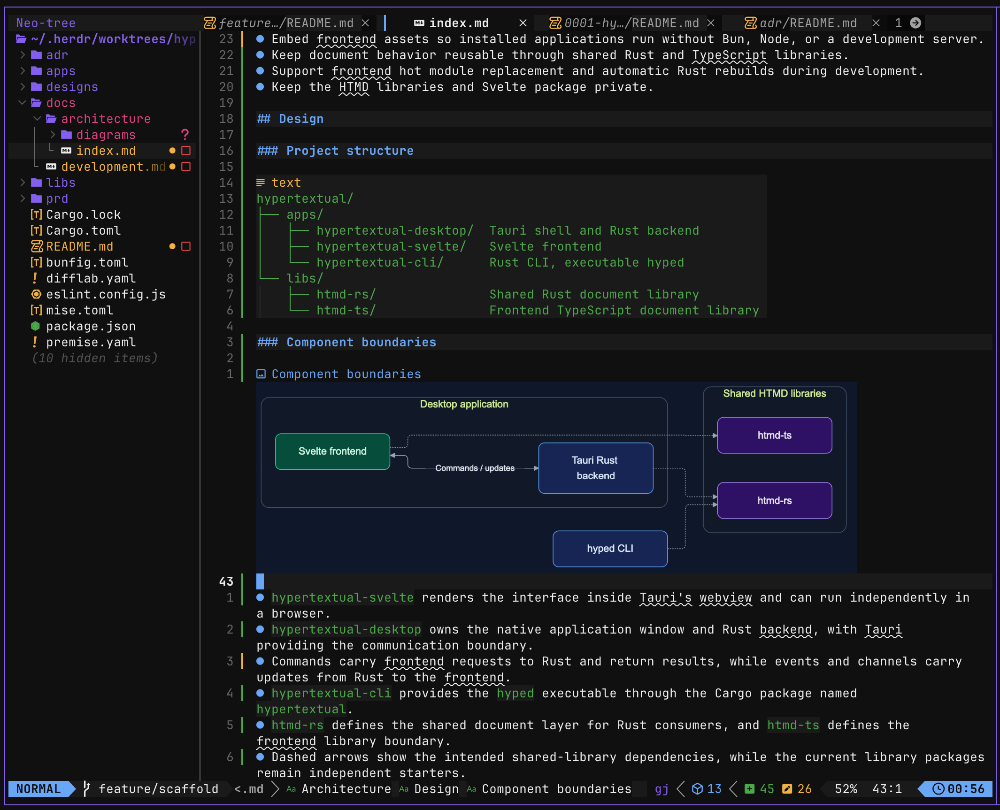

# MmdToImg

Render Mermaid diagrams on save and preview the correct theme in Neovim.
Each `.mmd` file generates an adaptive `.svg`, a `.light.png`, and a `.dark.png` beside the source.
Use a normal Markdown image link to the SVG.
Browsers select its theme with `prefers-color-scheme`.
The optional Snacks integration displays the PNG that matches `vim.o.background`.



## Prerequisites

- Neovim 0.10 or later.
- Mermaid CLI (`mmdc`) on your PATH: `npm install -g @mermaid-js/mermaid-cli`.
- Optional image previews: Snacks, a Markdown Treesitter parser, and a supported terminal such as Ghostty or Kitty.

## Installation

### lazy.nvim

Add this plugin specification:

```lua
{
  "skapoor8/MmdToImg",
  version = "*",
  lazy = false,
  main = "mmdtoimg",
  opts = {},
}
```

### vim-plug

Add the plugin to your vim-plug block and run `:PlugInstall`:

```vim
Plug 'skapoor8/MmdToImg', { 'tag': 'v0.1.0' }
```

Then configure the plugin:

```lua
require("mmdtoimg").setup()
```

### Native Git packages

Clone the plugin into Neovim's package directory:

```sh
git clone --branch v0.1.0 --depth 1 https://github.com/skapoor8/MmdToImg.git \
  ~/.local/share/nvim/site/pack/plugins/start/MmdToImg
```

Then call `require("mmdtoimg").setup()` from your Neovim configuration.
Adjust the package directory if you use a custom Neovim data directory.

## Usage

Save a `.mmd` file to generate its three image files.
For example, `docs/diagrams/architecture.mmd` produces `architecture.svg`, `architecture.light.png`, and `architecture.dark.png` in the same directory.
Reference the SVG in Markdown:

```markdown

```

Commit all three images with their source.
Readers can view the diagrams without installing Neovim or MmdToImg.

The plugin provides these commands:

- `:MmdToImg` renders the current `.mmd` file.
- `:MmdToImg path/to/diagram.mmd` renders another file.
- `:MmdToImgAll` renders Mermaid files beneath the Git root or current directory.
- `:MmdToImgAll path/to/diagrams` renders files beneath a selected directory.

The directory scan skips Git metadata, `node_modules`, `target`, and `.cache`.
Rendering runs in the background, one diagram at a time.
Saving a file again queues a fresh render.
Failed Mermaid commands leave the existing images in place.

## Snacks image previews

MmdToImg detects Snacks and configures image previews automatically.
No resolver configuration is needed.
It preserves an existing custom resolver and selects the matching PNG for Mermaid SVG links.
Markdown previews refresh after rendering and when the editor background changes.
Use `:set background=light` or `:set background=dark` to select a preview theme.
Set `snacks = false` in MmdToImg's configuration to disable automatic integration.

## Configuration

```lua
require("mmdtoimg").setup({
  command = "mmdc",
  auto_render = true,
  snacks = true,
  scale = 2,
  timeout = 120000,
  -- light_config = "/path/to/light.json",
  -- dark_config = "/path/to/dark.json",
  -- puppeteer_config = "/path/to/puppeteer.json",
})
```

`scale` sets the PNG resolution multiplier.
`timeout` limits each Mermaid command in milliseconds.
The bundled theme files define the layout and colors.
Custom theme files must produce the same layout in both themes.
`puppeteer_config` passes a Puppeteer configuration file to the Mermaid CLI.

## Development

The implementation and themes live in `libs/MmdToImg`.
The root Lua entry point lets Neovim load the plugin from this repository.
Install the tools and run the checks:

```sh
mise trust
mise install
mise run //libs/MmdToImg:install
mise run //libs/MmdToImg:build
mise run //libs/MmdToImg:lint
mise run //libs/MmdToImg:test
```

The tests cover rendering, theme selection, directory exclusions, rendering on save, and failed commands.
CI runs the tests on Neovim 0.10.4 and 0.12.6.
The plugin installs from Git and requires no uploaded release artifacts.

## License

[MIT](LICENSE).
